<div align="center">

<a href="https://always-on-intelligence.github.io/">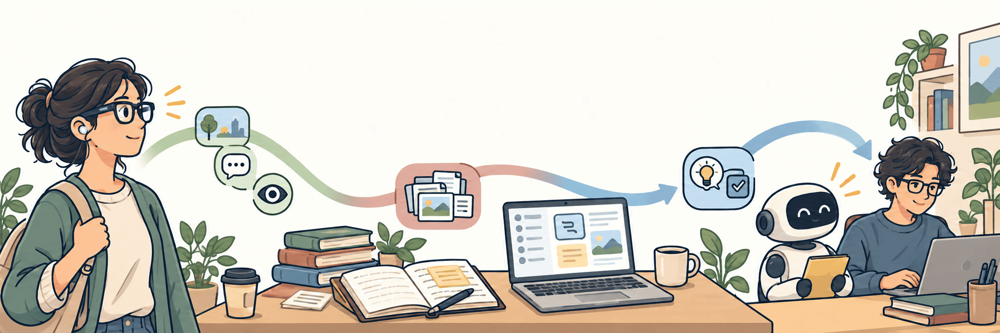</a>

<p>
  <a href="https://always-on-intelligence.github.io/"></a>
  <a href="https://always-on-intelligence.github.io/Always-On_Personal_Intelligence.pdf"></a>
  <a href="https://github.com/Always-On-Intelligence/awesome-always-on-personal-intelligence"></a>
  <a href="https://github.com/Always-On-Intelligence/HALO"></a>
</p>

<p>The project page of the survey<br>
<b><i>Always-On Personal Intelligence: A Roadmap Towards Continuing, Self-Evolving Loops</i></b><br>
<a href="https://always-on-intelligence.github.io/"><b>always-on-intelligence.github.io</b></a></p>

</div>

## What's on the page

<table>
  <tr>
    <td width="50%" valign="top">
      <a href="https://always-on-intelligence.github.io/#takeaways">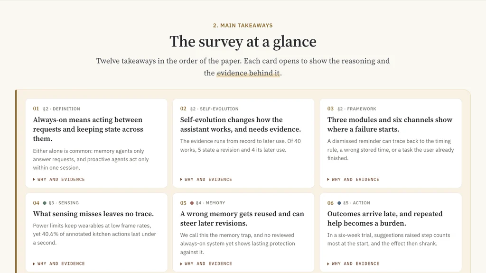</a>
      <p align="center"><b>Main takeaways</b> · The survey at a glance</p>
    </td>
    <td width="50%" valign="top">
      <a href="https://always-on-intelligence.github.io/#framework">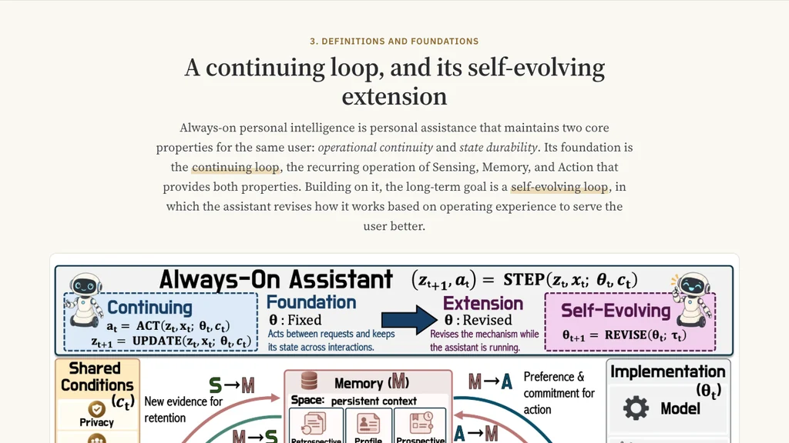</a>
      <p align="center"><b>Framework</b> · A continuing loop, and its self-evolving extension</p>
    </td>
  </tr>
  <tr>
    <td width="50%" valign="top">
      <a href="https://always-on-intelligence.github.io/play.html">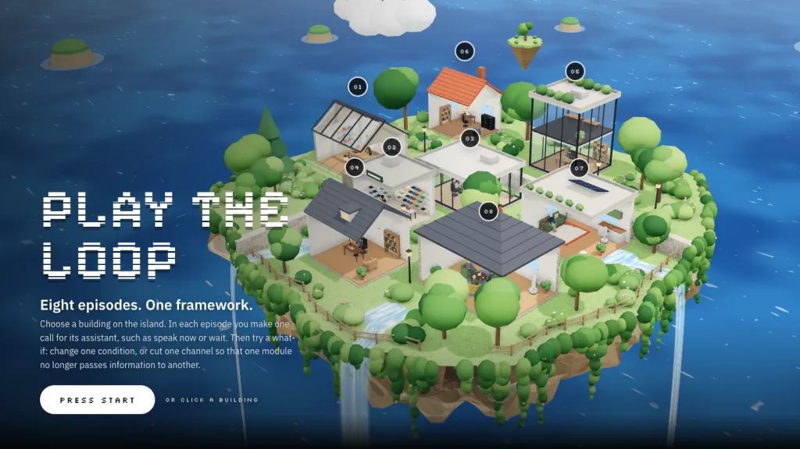</a>
      <p align="center"><b>Demo</b> · Play the loop</p>
    </td>
    <td width="50%" valign="top">
      <a href="https://always-on-intelligence.github.io/#applications">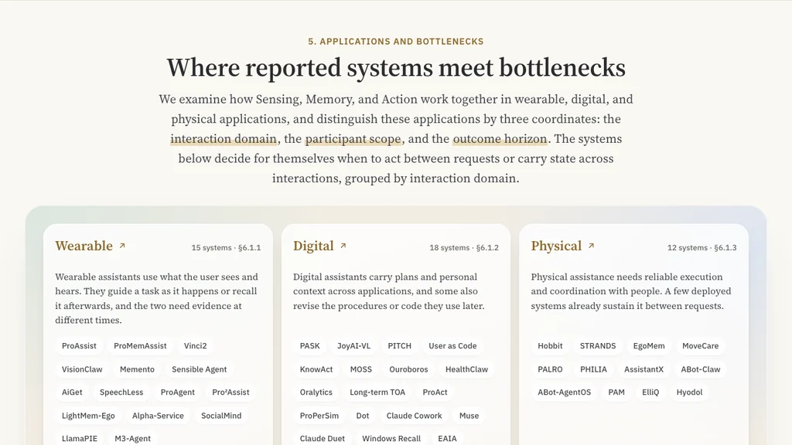</a>
      <p align="center"><b>Applications</b> · Where reported systems meet bottlenecks</p>
    </td>
  </tr>
  <tr>
    <td width="50%" valign="top">
      <a href="https://always-on-intelligence.github.io/#levels">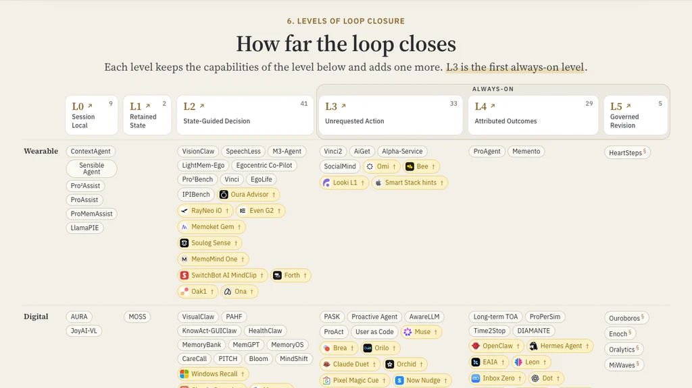</a>
      <p align="center"><b>Levels</b> · How far the loop closes</p>
    </td>
    <td width="50%" valign="top">
      <a href="https://always-on-intelligence.github.io/#halo">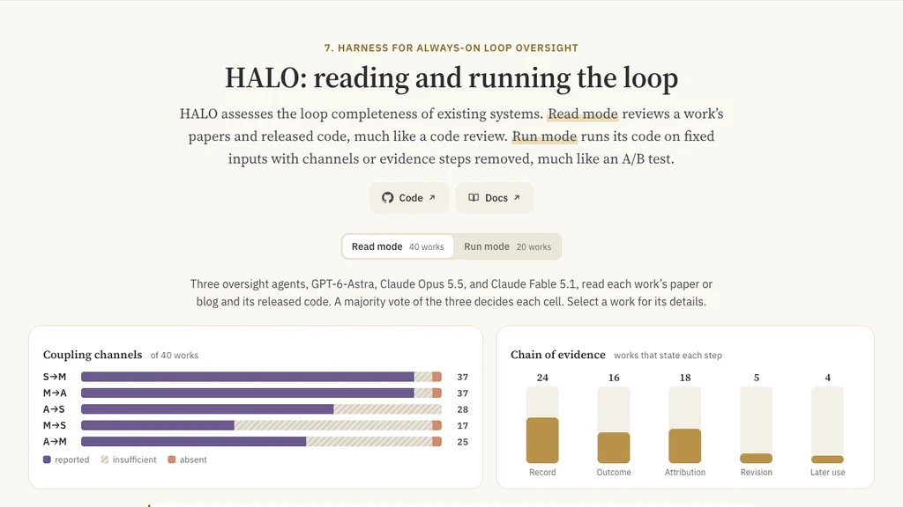</a>
      <p align="center"><b>HALO</b> · Reading and running the loop</p>
    </td>
  </tr>
</table>

## Demo

Eight playable episodes, from smart glasses to a home robot. In each one you make one call for its assistant, then try a what-if. **[Open the demo](https://always-on-intelligence.github.io/play.html)**

<table>
  <tr>
    <td width="33%" valign="top">
      <a href="https://always-on-intelligence.github.io/play.html">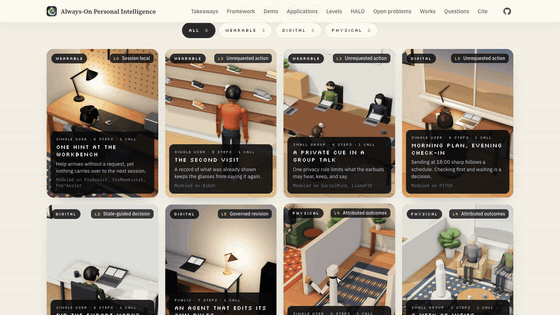</a>
      <p align="center"><b>Episode library</b></p>
    </td>
    <td width="33%" valign="top">
      <a href="https://always-on-intelligence.github.io/play.html#case-workbench">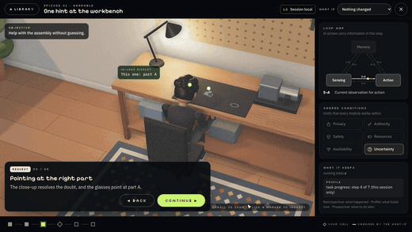</a>
      <p align="center"><b>One hint at the workbench</b></p>
    </td>
    <td width="33%" valign="top">
      <a href="https://always-on-intelligence.github.io/play.html#case-second-visit">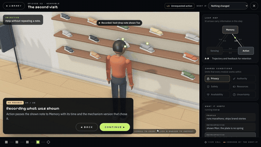</a>
      <p align="center"><b>The second visit</b></p>
    </td>
  </tr>
  <tr>
    <td width="33%" valign="top">
      <a href="https://always-on-intelligence.github.io/play.html#case-group-talk">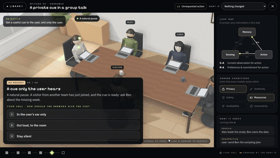</a>
      <p align="center"><b>A private cue in a group talk</b></p>
    </td>
    <td width="33%" valign="top">
      <a href="https://always-on-intelligence.github.io/play.html#case-daily-plan">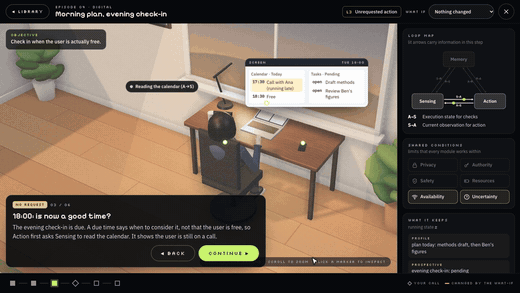</a>
      <p align="center"><b>Morning plan, evening check-in</b></p>
    </td>
    <td width="33%" valign="top">
      <a href="https://always-on-intelligence.github.io/play.html#case-export-check">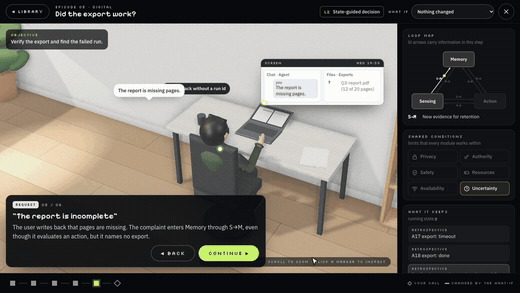</a>
      <p align="center"><b>Did the export work?</b></p>
    </td>
  </tr>
  <tr>
    <td width="33%" valign="top">
      <a href="https://always-on-intelligence.github.io/play.html#case-governed-revision">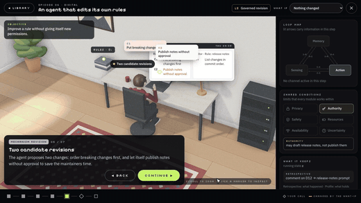</a>
      <p align="center"><b>An agent that edits its own rules</b></p>
    </td>
    <td width="33%" valign="top">
      <a href="https://always-on-intelligence.github.io/play.html#case-robot-cup">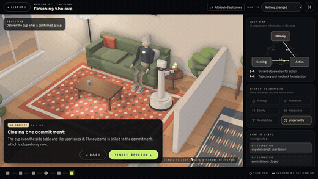</a>
      <p align="center"><b>Fetching the cup</b></p>
    </td>
    <td width="33%" valign="top">
      <a href="https://always-on-intelligence.github.io/play.html#case-care-visits">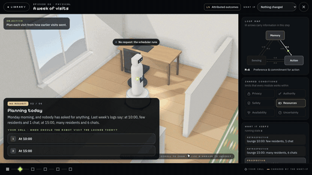</a>
      <p align="center"><b>A week of visits</b></p>
    </td>
  </tr>
</table>

## This repository

The site is static, with no build step: `index.html` is the paper's page and `play.html` is the Demo. The JSON files in `site/data/` are exported from the paper's LaTeX sources by the scripts in `tools/paper/`.

```sh
python3 -m http.server 8000 --bind 127.0.0.1   # then open http://127.0.0.1:8000/
node --test tests/*.test.mjs
```

[DEVELOPMENT.md](DEVELOPMENT.md) describes every file, the tests, how to publish, and where each part of the content comes from.

## Citation

```bibtex
@misc{alwayson2026roadmap,
  title  = {Always-On Personal Intelligence: A Roadmap Towards
            Continuing, Self-Evolving Loops},
  author = {Liu, Shuai and Guo, Hongming and Jin, Weiyang and Hu, Kairui and
            Tian, Shulin and Dong, Yuhao and Wu, Jinming and Zhang, Kaichen and
            Tang, Yujin and Han, Xinyang and Chai, Wenhao and Fu, Yuqian and
            Zhang, Ce and Zhang, Yuanhan and Kong, Lingdong and Siyao, Li and
            Yang, Jingkang and Bertasius, Gedas and Li, Manling and Wu, Jiajun and
            Wang, Mengdi and Song, Dawn and Liu, Ziwei},
  year   = {2026},
  note   = {Working draft},
  url    = {https://always-on-intelligence.github.io/}
}
```
